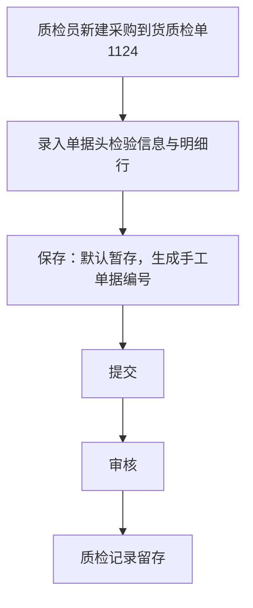

# 需求规格说明书 (Requirements Spec)

> **名称**: `采购到货质检单1124` | **版本**: `1.0.0` | **创建日期**: `2026-11-24` | **状态**: 待评审
> **需求简码**: `REQ-T1000001` | **场景类型**: `Create`
> **涉及应用**: `abxt_pm_ext`（采购管理扩展应用，用户指定）

---

## 1. 产品概述

### 1.1 产品背景

河钢采购管理需要在采购到货环节记录物料质检过程与结论。目前 abxt_pm_ext 应用下没有采购到货质检单据，检验日期、方式、结论及让步审批信息缺少统一录入载体。本次在 abxt_pm_ext 下新建“采购到货质检单1124”，承接采购到货后的质量检验记录。

### 1.2 功能范围

| 功能模块 | 说明 | 优先级 | 变更类型 |
| --- | --- | --- | --- |
| 采购到货质检单1124（单据） | 单据头 + 质检明细分录，含检验方式/质检结论枚举 | P0 | 🆕 |
| 功能分组：到货管理 | 在 abxt_pm_ext 下新建分组，承载本单据 | P0 | 🆕 |

### 1.3 目标用户

| 角色 | 描述 | 业务目标 |
| --- | --- | --- |
| 采购质检员 | 到货后执行检验的人员 | 录入检验过程与结论，留存质检记录 |
| 让步审批人 | 处理让步接收审批的人员 | 单据记录审批日期与审批人信息 |

---

## 2. 核心摘要

在 abxt_pm_ext 应用新建功能分组“到货管理”，并在其下新建“采购到货质检单1124”单据：单据头记录质检日期、检验时间、采购订单号、收料通知单号、检验员、检验方式、检验计划、质检结论、备注、审批日期、让步审批人；质检明细分录按行记录物料、规格型号、物料版本号、单位及是否合格。

---

## 3. 业务流程

标准苍穹单据流程（保存 → 提交 → 审核），手工唯一编号，不配置自动编号与审批流程（用户未要求）。

---

## 4. 用户故事

### 4.1 US-001 · 采购到货质检单1124

#### 4.1.1 基本信息

| 字段 | 值 |
| --- | --- |
| **故事ID** | US-001 |
| **故事名称** | 采购到货质检单1124 |
| **用户角色** | 采购质检员 |
| **优先级** | P0 |
| **场景类型** | Create |

**故事描述**：

> 作为 **采购质检员**，我想要可以 **在采购到货后录入质检单，记录检验方式、计划、结论及每行物料的合格情况**，以便于 **留存质检过程并支撑后续让步审批与业务追溯**。

#### 4.1.2 业务对象

| 属性 | 值 | 角色 | 状态 |
| --- | --- | --- | --- |
| 实体名称 | 采购到货质检单1124 | **主业务对象（建模对象）** | `Create` |
| 实体类型 | 单据 | | |
| 应用编码 | abxt_pm_ext | | |
| 功能分组 | 到货管理（本次新建，用户已确认） | | |
| 名称 | 物料 | 引用基础资料（明细行引用主数据） | `Existing` |
| 名称 | 计量单位 | 引用基础资料（明细行引用主数据） | `Existing` |

> 对象身份说明：新建单据的实体/表单编码由开发阶段按所选环境命名契约生成，本文不臆造编码。物料、计量单位为标准基础资料，本应在选定环境在线核实确切表单编码；本次环境连接认证失败（详见 [对象发现证据](evidence/read-app-forms-4/objects.md)：`getAppToken failed: 第三方应用ID或应用密钥不正确`），对象身份核实列为受影响依赖（见第 7、8 节），不预设“已核实”。

#### 4.1.3 用户界面

- **终端要求**：PC 端

**单据头字段列表**（11 个，按原文顺序）：

| # | 显示名 | 字段类型 | 必填 | 默认值 | 引用来源 | 修改状态 | 说明 |
| - | ---------- | ---------- | :--: | ---------- | -------------------- | ------------ | ---------- |
| 1 | 质检日期 | 日期 | - | - | - | 🆕 | 检验执行日期 |
| 2 | 检验时间 | 时间（日期时间） | - | - | - | 🆕 | 检验执行时点；与质检日期分列，控件选型由开发决定 |
| 3 | 采购订单号 | 文本 | - | - | - | 🆕 | 原文仅要求录入单号，未要求引用采购订单单据 |
| 4 | 收料通知单号 | 文本 | - | - | - | 🆕 | 原文仅要求录入单号，未要求引用收料通知单据 |
| 5 | 检验员 | 文本 | - | - | - | 🆕 | 原文未指明是否引用人员基础资料，按文本录入（假设，见第 7 节） |
| 6 | 备注 | 多行文本 | - | - | - | 🆕 | 原文明确“备注多行文本” |
| 7 | 审批日期 | 日期 | - | - | - | 🆕 | 让步审批的日期 |
| 8 | 让步审批人 | 文本 | - | - | - | 🆕 | 让步审批的人员 |
| 9 | 检验方式 | 下拉（Combo） | - | - | 枚举：全检、抽检、免检 | 🆕 | 固定三项，无其他取值 |
| 10 | 检验计划 | 文本 | - | - | - | 🆕 | 原文未指明类型与来源，按文本录入（假设，见第 7 节） |
| 11 | 质检结论 | 下拉（Combo） | - | - | 枚举：待检验、合格、不合格、让步接收、部分合格 | 🆕 | 固定五项，无其他取值 |

**质检明细（分录）字段列表**（6 列）：

| # | 显示名 | 字段类型 | 必填 | 默认值 | 引用来源 | 修改状态 | 说明 |
| - | ---------- | ---------- | :--: | ---------- | -------------------- | ------------ | ---------- |
| 1 | 编号 | 行序号 | - | 平台自动 | - | 🆕 | 分录行号 |
| 2 | 物料 | 物料基础资料引用 | - | - | 物料（标准基础资料，编码待环境核实） | 🆕 | 检验对象物料 |
| 3 | 规格型号 | 文本 | - | - | - | 🆕 | 物料规格型号；原文未要求自动带出 |
| 4 | 物料版本号 | 文本 | - | - | - | 🆕 | 物料版本标识 |
| 5 | 单位 | 计量单位 | - | - | 计量单位（标准基础资料，编码待环境核实） | 🆕 | 检验数量单位；控件选型（文本/引用）由开发决定 |
| 6 | 是否合格 | 下拉（Combo） | - | - | 枚举：合格、不合格 | 🆕 | 行级结论；原文仅要求“是否”，合格/不合格两个取值 |

**操作按钮**：保存、提交、审核、删除、复制等沿用平台标准单据操作（用户未提出自定义按钮与点击前业务校验）。

#### 4.1.4 业务规则

| 规则编码 | 场景 | 触发时机 | 具体配置 | 说明 |
| --------- | --------------- | ---------- | ---------- | -------- |
| `VAL-01` | 检验方式取值 | 录入/保存 | 枚举仅允许：全检、抽检、免检 | 原文明确三项 |
| `VAL-02` | 质检结论取值 | 录入/保存 | 枚举仅允许：待检验、合格、不合格、让步接收、部分合格 | 原文明确五项 |
| `VAL-03` | 是否合格取值 | 录入/保存 | 枚举仅允许：合格、不合格 | 行级结论 |

- 无用户提出的计算、联动、控制规则；保存默认暂存（平台默认，业务字段未录齐可保存），提交/审核沿用平台标准行为。
- 必填性：用户未指定任何业务必填字段，不新增保存业务校验；平台原有数据约束（单据编号等系统字段）继续适用。

**场景验证**：

| # | 场景类型 | 场景描述 | 预期结果 |
| - | -------- | ---------- | ---------- |
| 1 | 正常 | 录入头字段与多行明细后保存 | 保存成功，生成手工唯一单据编号 |
| 2 | 正常 | 检验方式选择“抽检”，质检结论选择“让步接收” | 枚举取值合法，保存成功 |
| 3 | 边界 | 保存时未录任何业务字段 | 按平台默认可暂存；不新增业务校验 |

#### 4.1.5 安全

沿用平台默认：基于角色的访问控制、租户隔离；用户未提出敏感字段脱敏、加密或额外权限项，不扩展。

#### 4.1.6 关联配置

| 配置项 | 是否支持 | 说明 |
| -------- | :---------: | ------------------- |
| 打印配置 | - | 用户未要求，交由平台默认 |
| 导入导出 | - | 用户未要求 |
| BOTP配置 | - | 用户未要求 |
| 流程配置 | - | 用户未要求审批流程；“审批日期、让步审批人”仅作为记录字段 |

#### 4.1.7 关联依赖

| # | 依赖来源 | 类型 | 被调用内容 | 说明 |
| - | ---------- | ---- | --------------- | ------------------ |
| 1 | 物料（标准基础资料） | 引用 | 明细行“物料”字段引用目标 | 目标编码待环境核实（认证失败） |
| 2 | 计量单位（标准基础资料） | 引用 | 明细行“单位”字段引用目标 | 目标编码待环境核实（认证失败） |

---

## 5. 业务需求

### 5.1 功能性需求

| ID | 需求描述 | 优先级 | 变更类型 | 对应故事 |
| ---------------- | ------------------------------------------------------- | ------ | -------- | -------- |
| **FR-001** | 在 abxt_pm_ext 应用新建功能分组“到货管理”并在其下新建单据“采购到货质检单1124”（单据头 + 质检明细分录） | P0 | 🆕 | US-001 |
| **FR-002** | 单据头包含：质检日期、检验时间、采购订单号、收料通知单号、检验员、备注（多行文本）、审批日期、让步审批人、检验方式（下拉：全检/抽检/免检）、检验计划、质检结论（下拉：待检验/合格/不合格/让步接收/部分合格） | P0 | 🆕 | US-001 |
| **FR-003** | 质检明细分录包含：编号、物料、规格型号、物料版本号、单位、是否合格 | P0 | 🆕 | US-001 |
| **FR-004** | 单据沿用平台标准保存→提交→审核流程与手工唯一编号 | P0 | 🆕 | US-001 |

### 5.2 非功能性需求

沿用苍穹平台默认约束（单次查询 ≤1万条、保存 ≤2000条、响应 ≤50秒）、RBAC 与租户隔离；用户未提出额外指标。

---

## 6. 验收标准 (AC)

- [ ] **AC-US001-01**：在 abxt_pm_ext 下可见新建功能分组“到货管理”，其下可新建“采购到货质检单1124”。
- [ ] **AC-US001-02**：新建单据页面，单据头依次出现质检日期、检验时间、采购订单号、收料通知单号、检验员、备注（多行文本）、审批日期、让步审批人、检验方式、检验计划、质检结论 11 个字段。
- [ ] **AC-US001-03**：检验方式下拉有且仅有“全检、抽检、免检”三个选项。
- [ ] **AC-US001-04**：质检结论下拉有且仅有“待检验、合格、不合格、让步接收、部分合格”五个选项。
- [ ] **AC-US001-05**：质检明细可新增多行，每行包含编号、物料、规格型号、物料版本号、单位、是否合格 6 列；行级“是否合格”取值为“合格/不合格”。
- [ ] **AC-US001-06**：录入头字段与明细后执行保存，保存成功且生成手工唯一单据编号；单据可执行提交、审核。

---

## 7. 假设条件

| # | 假设 | 影响 | 状态 |
| - | ---------- | ---------- | ------ |
| 1 | “检验员”“让步审批人”按文本录入（原文未指明是否引用人员/员工基础资料） | 若需引用基础资料，字段类型与引用目标需调整 | assumed |
| 2 | “采购订单号”“收料通知单号”按文本录入（原文仅要求“号”，未要求引用单据或带出数据） | 若需引用单据，须补充引用与取数映射 | assumed |
| 3 | “检验计划”按文本录入（原文未指明类型、枚举或来源） | 若实际是已有单据/基础资料引用，须补充定义 | assumed |
| 4 | “检验时间”为时间/日期时间类字段，与“质检日期”分列 | 控件具体选型由开发决定 | assumed |
| 5 | 行级“是否合格”取值“合格/不合格”（原文仅写“是否合格”） | 若需布尔勾选或更多取值须确认 | assumed |
| 6 | 标准流程：保存→提交→审核、手工唯一编号、保存默认暂存 | 平台默认行为，非用户显式要求 | assumed |

以上假设均不改变原文字段清单与枚举取值；开发阶段如与用户实际业务不符，以用户后续澄清为准。

---

## 8. 问题记录与澄清

**问题记录**：

| # | 问题描述 | 影响 | 状态 |
| - | ---------- | ---------- | ------ |
| 1 | 环境连接认证失败（`getAppToken failed: 第三方应用ID或应用密钥不正确`，环境：金蝶云科技有限公司 / std082.test.kdgalaxy.com） | 物料、计量单位等引用目标的确切表单编码无法在线核实；对象身份核验受阻（证据：[evidence/read-app-forms-4/objects.md](evidence/read-app-forms-4/objects.md)） | pending（依赖有效连接） |

**问题澄清**：

### 2026-11-24 用户确认

- 问：新建的“采购到货质检单1124”表单应放在 abxt_pm_ext 应用下的哪个功能分组？
  答：**新建“到货管理”分组**（已同步至 4.1.2、FR-001、AC-US001-01）。

---

## 9. 变更历史

| 版本 | 日期 | 变更描述 |
| ----- | ---------- | -------- |
| 1.0.0 | 2026-11-24 | 初始版本：依据 Issue T1000001 原始需求整理 |
